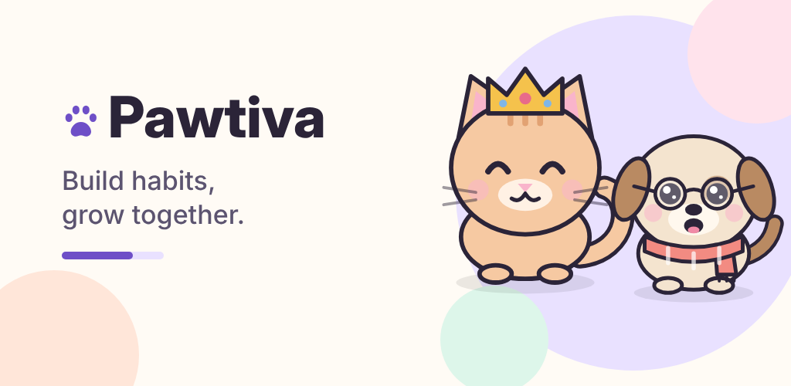

# Pawtiva



**Build your habits, grow your little friend together.**

Pawtiva is an offline-first Android habit tracker with a virtual pet companion. Tick off small daily
habits, earn XP and PawCoins, level up together with a kitten or a puppy, and dress your friend up
with cosmetic accessories. No account, no ads, no subscriptions — everything stays on your device.

▶️ **Promo video:** 


https://github.com/user-attachments/assets/d0c007e0-fff9-48a1-85d3-d58c57544cb7


## Features

- **Companion** — choose a kitten or a puppy, name it, switch any time without losing progress. Five moods react to your day.
- **Daily habits** — create, edit and delete habits with an icon (or any emoji from your keyboard) and a color. Tick off today or fill in any of the last 7 days.
- **XP and levels** — +10 XP per habit, `level = floor(totalXp / 100) + 1`, celebrations on level-up and when the whole day is done. A missed day never takes progress away.
- **PawCoins shop** — +5 PawCoins per habit; spend them on a cap, glasses, scarf, headset, flower or crown. Preview on your pet before buying. No real-money purchases.
- **Statistics and achievements** — weekly chart, monthly calendar, history and seven achievements, all computed from your own records.
- **Reminders** — one gentle daily reminder at your chosen time, only with your permission.
- **Made for you** — Turkish and English, light/dark/system theme, dynamic color, date format, reduced motion.
- **Privacy** — works fully offline with Room and DataStore; export your data as JSON or reset everything.

## Tech

| | |
| --- | --- |
| Language / UI | Kotlin, Jetpack Compose, Material 3 |
| Architecture | MVVM, StateFlow, Hilt, multi-module |
| Storage | Room (habits, completions, coin ledger, inventory, achievements), Preferences DataStore |
| Tests | JUnit, kotlinx-coroutines-test, Robolectric, Compose UI tests |
| Application ID | `com.nisaefendioglu.pawtiva.app` (1.0.0, versionCode 1) |
| SDK | minSdk 26 · targetSdk 36 · compileSdk 36 |
| Build | AGP 8.12.0 · Gradle 8.13 · Kotlin 2.2.10 · JDK 17+ |

## Modules

- `app` — entry point, navigation, Hilt application, daily reminder alarms and receivers
- `core:model` — pure Kotlin models
- `core:domain` — pure Kotlin business rules: XP/levels, rewards, 7-day edit window, mood, achievements, statistics, shop catalog
- `core:database` — Room database
- `core:datastore` — Preferences DataStore
- `core:data` — repositories (transactions for rewards and purchases), export/reset, language controller
- `core:designsystem` — theme tokens, typography, icons, reusable components, code-drawn pets and accessories
- `feature:onboarding`, `feature:home`, `feature:habits`, `feature:shop`, `feature:statistics`, `feature:settings`

More detail: [`docs/technical-overview.md`](docs/technical-overview.md).

## Build and test

Open the project in Android Studio (Narwhal Feature Drop 2025.1.2 or newer), or from a terminal:

```bash
./gradlew :app:assembleDebug          # debug APK
./gradlew testDebugUnitTest           # JVM unit + Robolectric UI tests (no emulator needed)
./gradlew lintDebug                   # static analysis
```

## Release

Release signing reads a local, git-ignored `keystore.properties`; keys and passwords are never committed.
See [`docs/play-release-checklist.md`](docs/play-release-checklist.md) and the store listing, privacy
policy and graphics in [`store/`](store) and [`docs/`](docs).
